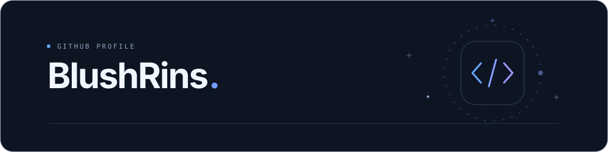

  <picture>
    <source media="(prefers-color-scheme: dark)" srcset="https://raw.githubusercontent.com/BlushRins/BlushRins/main/assets/header-dark.svg">
    <source media="(prefers-color-scheme: light)" srcset="https://raw.githubusercontent.com/BlushRins/BlushRins/main/assets/header-light.svg">
    
  </picture>

<h3 align="center">Languages I use</h3>

  
  
  
  
  

  

