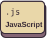

<picture>
  <source media="(prefers-reduced-motion: no-preference)" srcset="https://raw.githubusercontent.com/BlushRins/BlushRins/main/assets/introduction.svg">
  
</picture>

I’m learning software development through C data structures, offline web apps, and tools for studying.

Here’s how I walk a linked list in C, one pointer at a time.

```c
for (const struct Node *node = head; node != NULL; node = node->next) {
    printf("%d\n", node->value);
}
```

[See how the nodes connect](https://github.com/BlushRins/obsidian-study-vault/blob/HEAD/notes/linked-list-nodes.md)

## Languages on my keyboard

Pick a key to explore the code. The PHP key opens the official manual.

<p>
  <a href="https://github.com/BlushRins/obsidian-study-vault/blob/HEAD/notes/linked-list-nodes.md"></a>
  <a href="https://github.com/BlushRins/EmployeeProject_Llenos/blob/HEAD/src/version3/HourlyEmployee.java"></a>
  <a href="https://www.php.net/manual/en/language.oop5.basic.php"></a>
  <a href="https://github.com/BlushRins/obsidian-study-vault/blob/HEAD/.githooks/pre-commit"></a>
  <a href="https://github.com/BlushRins/millennium-command-center-site/blob/HEAD/index.html"></a>
  <a href="https://github.com/BlushRins/millennium-command-center-site/blob/HEAD/style.css"></a>
  <a href="https://github.com/BlushRins/lift-tracker/blob/HEAD/sw.js"></a>
  <a href="https://github.com/BlushRins/Studyhub/blob/HEAD/components/note/NoteViewer.tsx"></a>
</p>

## On my workbench

### Lift Tracker

Between sets, I want to know what I lifted last time and what to aim for next. Lift Tracker keeps both on one screen, logs sets offline, and saves the history on my phone.

**20-second demo.** [Open Lift Tracker](https://blushrins.github.io/lift-tracker/), pick Squat, enter 20 kg and 5 reps, then tap **Log set 1**. Refresh and look under **Today** for the set you just saved.

[View source](https://github.com/BlushRins/lift-tracker)

### Study Hub

I keep my data structures notes in Obsidian. Study Hub turns the same Markdown files into a web reader with code examples and diagrams. My bit-vector notes show how eight yes-or-no answers fit into a single byte.

**One-byte challenge.** If the rightmost bit represents 0, which numbers belong to the set `0b00101100`?

<details>
<summary>Check your answer</summary>

`{2, 3, 5}`. Count positions from the right, starting at 0. The three ones sit at positions 2, 3, and 5.

</details>

[Explore the bit-vector notes](https://github.com/BlushRins/Studyhub/blob/HEAD/content/Bit-Vector%20Sets.md#1-the-core-idea) · [View source](https://github.com/BlushRins/Studyhub)

## Contribution trail

My past year on GitHub


<picture>
  <source media="(prefers-reduced-motion: no-preference)" srcset="https://raw.githubusercontent.com/BlushRins/BlushRins/contribution-art/snake.svg">
  
</picture>
