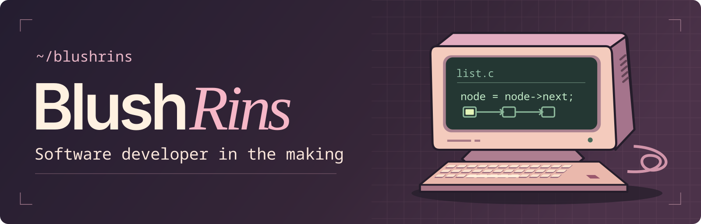
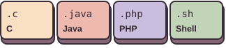
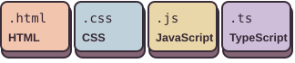

<picture>
  <source media="(prefers-reduced-motion: no-preference)" srcset="https://raw.githubusercontent.com/BlushRins/BlushRins/main/assets/workbench.svg">
  
</picture>

Most of my projects start with something I want to use. So far, that’s meant a lifting log for the gym and a better way to read my course notes.

## Languages on my keyboard

  
  

I practice [data structures in C](https://github.com/BlushRins/obsidian-study-vault/blob/HEAD/notes/linked-list-insertion.md), write [course projects in Java](https://github.com/BlushRins/EmployeeProject_Llenos), and use TypeScript for my study tools.

## On my workbench

### Lift Tracker

Between sets, I want to know what I lifted last time and what to aim for next. Lift Tracker keeps both on one screen, logs sets offline, and saves the history on my phone.

[Open Lift Tracker ↗](https://blushrins.github.io/lift-tracker/) · [View source](https://github.com/BlushRins/lift-tracker)

### Study Hub

I keep my data structures notes in Obsidian. Study Hub turns the same Markdown files into a web reader with code examples and diagrams. My bit-vector notes show how eight yes-or-no answers fit into a single byte.

[Read the bit-vector notes ↗](https://github.com/BlushRins/Studyhub/blob/HEAD/content/Bit-Vector%20Sets.md) · [View source](https://github.com/BlushRins/Studyhub)
