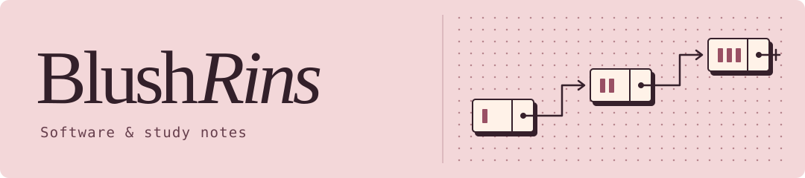

I build small tools for my workouts and coursework. Two of them live here.

### Lift Tracker

Between sets, I want to know what I lifted last time and what to aim for next. Lift Tracker keeps that on one screen, logs sets offline, and stores the history on the device.

[Open Lift Tracker](https://blushrins.github.io/lift-tracker/) · [Source code](https://github.com/BlushRins/lift-tracker)

### Study Hub

I keep my data structures notes in Obsidian. Study Hub turns those same Markdown files into a web reader, with linked definitions, code examples, and diagrams. The bit-vector notes walk through how a set fits into a handful of bits.

[Read the bit-vector notes](https://github.com/BlushRins/Studyhub/blob/HEAD/content/Bit-Vector%20Sets.md) · [Explore Study Hub](https://github.com/BlushRins/Studyhub)
