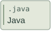
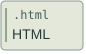
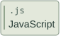
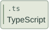

<picture>
  <source media="(max-width: 640px) and (prefers-reduced-motion: reduce)" srcset="https://raw.githubusercontent.com/BlushRins/BlushRins/main/assets/meadow/field-mobile-still.jpg">
  <source media="(max-width: 640px)" srcset="https://raw.githubusercontent.com/BlushRins/BlushRins/main/assets/meadow/field-mobile.svg">
  <source media="(prefers-reduced-motion: no-preference)" srcset="https://raw.githubusercontent.com/BlushRins/BlushRins/main/assets/meadow/field.svg">
  
</picture>

I build small tools for the places I use them. At the gym, that means a log that works without a signal. At my desk, it means a reader for the data structures notes I keep in Obsidian.

## Projects

###  Lift Tracker

Between sets, I want to see what I lifted last time. Lift Tracker keeps that number beside the set I’m logging and saves my history on my phone.

**Try it in 20 seconds.** Pick Squat, enter 20 kg and 5 reps, and log the set. Refresh the page and you’ll find it under **Today**.

[Open Lift Tracker](https://blushrins.github.io/lift-tracker/) · [Source code](https://github.com/BlushRins/lift-tracker)

###  Study Hub

I wanted to publish my course notes without maintaining two copies. Study Hub reads the same Markdown files I edit in Obsidian, including their linked definitions, code examples, and diagrams.

[Read a note on bit vectors](https://github.com/BlushRins/Studyhub/blob/HEAD/content/Bit-Vector%20Sets.md#1-the-core-idea) · [Source code](https://github.com/BlushRins/Studyhub)

## Languages

Each language opens an example from my work. PHP opens the official manual.

<p>
  <a href="https://github.com/BlushRins/obsidian-study-vault/blob/HEAD/notes/linked-list-nodes.md"></a>
  <a href="https://github.com/BlushRins/EmployeeProject_Llenos/blob/HEAD/src/version3/HourlyEmployee.java"></a>
  <a href="https://www.php.net/manual/en/language.oop5.basic.php"></a>
  <a href="https://github.com/BlushRins/obsidian-study-vault/blob/HEAD/.githooks/pre-commit"></a>
  <a href="https://github.com/BlushRins/millennium-command-center-site/blob/HEAD/index.html"></a>
  <a href="https://github.com/BlushRins/millennium-command-center-site/blob/HEAD/style.css"></a>
  <a href="https://github.com/BlushRins/lift-tracker/blob/HEAD/sw.js"></a>
  <a href="https://github.com/BlushRins/Studyhub/blob/HEAD/components/note/NoteViewer.tsx"></a>
</p>

## Field notes

<details>
<summary>How do you walk a linked list in C?</summary>

Start at the head. Read the value, follow the next pointer, and stop when the pointer is null.

```c
for (const struct Node *node = head; node != NULL; node = node->next) {
    printf("%d\n", node->value);
}
```

[See how the nodes connect](https://github.com/BlushRins/obsidian-study-vault/blob/HEAD/notes/linked-list-nodes.md)

</details>

<details>
<summary>One-byte challenge · Which set does <code>0b00101100</code> represent?</summary>

`{2, 3, 5}`. Number the bits from right to left, starting at 0. The ones are in positions 2, 3, and 5.

[See how a byte stores a set](https://github.com/BlushRins/Studyhub/blob/HEAD/content/Bit-Vector%20Sets.md#1-the-core-idea)

</details>

## Contribution trail

Activity over the past year, refreshed daily.


<picture>
  <source media="(prefers-reduced-motion: no-preference)" srcset="https://raw.githubusercontent.com/BlushRins/BlushRins/contribution-art/snake.svg">
  
</picture>
