<picture>
  <source media="(max-width: 640px) and (prefers-reduced-motion: reduce)" srcset="https://raw.githubusercontent.com/BlushRins/BlushRins/main/assets/introduction-mobile-still.png">
  <source media="(max-width: 640px)" srcset="https://raw.githubusercontent.com/BlushRins/BlushRins/main/assets/introduction-mobile-loop.png">
  <source media="(prefers-reduced-motion: reduce)" srcset="https://raw.githubusercontent.com/BlushRins/BlushRins/main/assets/introduction-still.png">
  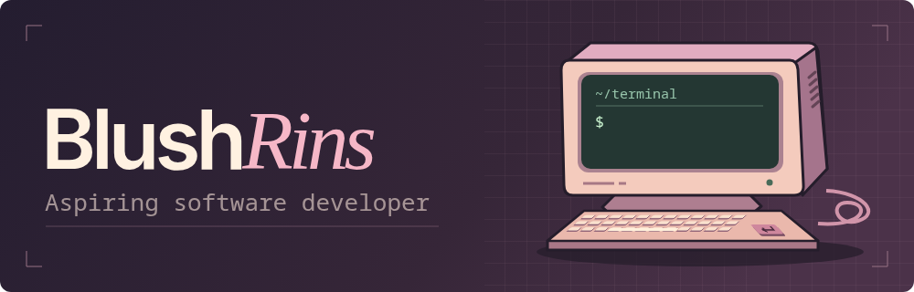
</picture>

<h2 align="center">Matthew Llenos</h2>

<p align="center"><strong>Aspiring software developer</strong><br><code>C data structures / offline web apps / study tools</code></p>

<p align="center">
  <a href="https://www.instagram.com/44_matteo_mat/"></a>
  <a href="#on-my-workbench"></a>
</p>

## About me

<picture>
  <source media="(prefers-reduced-motion: reduce)" srcset="https://raw.githubusercontent.com/BlushRins/BlushRins/main/assets/profile-card/terminal-still.png">
  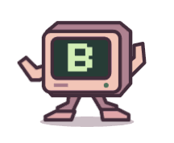
</picture>

I go by **BlushRins** online. Two things I keep track of are what I lifted last week and what I learned in class. That’s where Lift Tracker and Study Hub started.

I’m learning C by working through data structures. In a linked list, each node holds a value and a pointer. Following those pointers lets me read the whole list.

```c
for (const struct Node *node = head; node != NULL; node = node->next) {
    printf("%d\n", node->value);
}
```

<p>
  
</p>

[See how the nodes connect](https://github.com/BlushRins/obsidian-study-vault/blob/HEAD/notes/linked-list-nodes.md)

Here is where I am in the course. Each checkpoint links to the next, like the nodes above.

<p>
  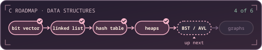
</p>

## Right now

<p>
  
</p>

## Languages on my keyboard

Pick a key to explore the code. The PHP key opens the official manual.

<p>
  <a href="https://github.com/BlushRins/obsidian-study-vault/blob/HEAD/notes/linked-list-nodes.md"></a>
  <a href="https://github.com/BlushRins/EmployeeProject_Llenos/blob/HEAD/src/version3/HourlyEmployee.java">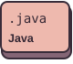</a>
  <a href="https://www.php.net/manual/en/language.oop5.basic.php"></a>
  <a href="https://github.com/BlushRins/obsidian-study-vault/blob/HEAD/.githooks/pre-commit"></a>
  <a href="https://github.com/BlushRins/millennium-command-center-site/blob/HEAD/index.html"></a>
  <a href="https://github.com/BlushRins/millennium-command-center-site/blob/HEAD/style.css"></a>
  <a href="https://github.com/BlushRins/lift-tracker/blob/HEAD/sw.js"></a>
  <a href="https://github.com/BlushRins/Studyhub/blob/HEAD/components/note/NoteViewer.tsx"></a>
</p>

## On my workbench

### 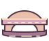 SignBridge

I want a conversation to work both ways between someone who signs and someone who speaks. SignBridge is the web app I’m building for that: signs and gestures become speech, and speech becomes live captions.

**Status: in progress.** The repository is still a stub, so the card below is a sketch of the idea, not a screenshot.

<p>
  
</p>

<p>
  <a href="https://github.com/BlushRins/SignBridge"></a>
</p>

### 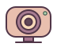 Camera trackers

I wanted my webcam to do something fun. Camera trackers shows a mirrored webcam in a resizable window. Hold a gesture, like a thumbs up, and it loops that gesture’s track and shows its picture on the opposite side. The camera feed is processed locally.

**Try it.** On Linux with a webcam, run `.venv/bin/python -m camera_trackers` and hold a thumbs up for about 0.2 seconds. Lower your hand out of view to stop the music.

<p>
  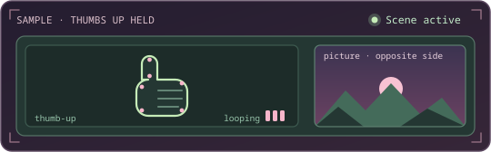
</p>

<p>
  <a href="https://github.com/BlushRins/camera-trackers"></a>
</p>

###  Lift Tracker

Between sets, I want to know what I lifted last time and what to aim for next. Lift Tracker keeps both on one screen, logs sets offline, and saves the history on my phone.

**20-second demo.** Open Lift Tracker, pick **Squat**, enter **20 kg** and **5 reps**, then tap **Log set 1**. Refresh and look under **Today** for the set you just saved.

<p>
  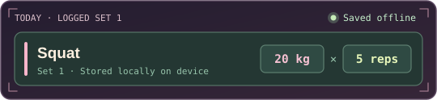
</p>

<p>
  <a href="https://blushrins.github.io/lift-tracker/"></a>
  <a href="https://github.com/BlushRins/lift-tracker"></a>
</p>

###  Study Hub

I keep my data structures notes in Obsidian. Study Hub turns the same Markdown files into a web reader with code examples and diagrams. My bit-vector notes show how eight yes-or-no answers fit into a single byte.

**One-byte challenge.** If the rightmost bit represents 0, which numbers belong to the set `0b00101100`?

<p>
  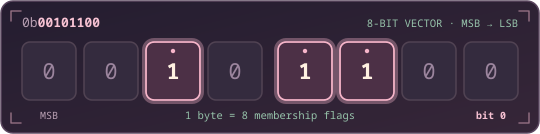
</p>

<details>
<summary>Check your answer</summary>

`{2, 3, 5}`. Count positions from the right, starting at 0. The three ones sit at positions 2, 3, and 5.

</details>

<p>
  <a href="https://github.com/BlushRins/Studyhub/blob/HEAD/content/Bit-Vector%20Sets.md#1-the-core-idea"></a>
  <a href="https://github.com/BlushRins/Studyhub"></a>
</p>

## Contribution trail

My past year on GitHub

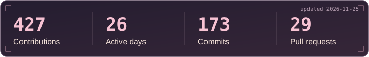

<picture>
  <source media="(prefers-reduced-motion: no-preference)" srcset="https://raw.githubusercontent.com/BlushRins/BlushRins/contribution-art/snake.svg">
  
</picture>

<p align="center">
  
</p>

<p align="center">
  <a href="https://www.instagram.com/44_matteo_mat/"></a>
  <a href="#"></a>
</p>
